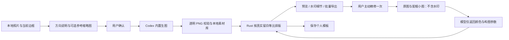

# 留白 0.6：艺术边框与 Codex 生图实现方案

## 已实现的三个入口

| 入口 | 模型做什么 | 本机做什么 | 调用次数 |
|---|---|---|---|
| 设计模板 | 不调用模型 | 11 套原创构图按真实边框重排；改三色与强度 | 0 |
| 参数配框 / 精修一次 | 看已展示的小图，返回受约束的设计参数 | 校验、排版、合成，预览后手动应用 | 三套配框一次；精修另一次 |
| Codex 手绘素材 | 内置 image_generation 生成真正的透明 PNG | 验证 PNG、持久保存、等比装框，支持保存模板 | 每次点击一张，之后复用 |

## 设计模板

潮汐留白、山间等高线、枝叶笺、丝带交响、月相书签、山茶纸笺、拱廊拾光、星轨、午后猫咪、折页旅记、水彩桉叶。十套使用有意的连续线条、成组插画与安静的留白；水彩桉叶使用本次通过 Codex 实际生成的透明植物素材。模板库按线条、植物、几何、插画筛选，个人模板与内置集合分开。

每套构图是小型白名单 recipe（模板 ID、三色、强度），不运行模型代码或任意 SVG。实际排版根据照片边界与上下左右留白计算。图案保持像素等比，线条沿当前边框带铺开；固定比例保持用户的选择，完整保留照片。水彩角花利用自身透明区贴合左下角。

新生成的矢量场景记录参考几何：长线绑定所在边框带重排，独立图案等比缩放。0.5 及之前未记录参考尺寸的个人模板保留原来外观，无法推断原始照片的构图意图；它们不等于新模板的完整自适应能力。极窄边框会缩小或隐藏装饰，照片区域始终受保护。旧矢量复杂跨区曲线仍可能需要手动调整留白。

## Codex 接入方式

本机已验证的 CLI 是 0.169.0-alpha.11.1，支持内置 image_generation。应用调用 `codex exec`，复用现有登录；CLI 不随轻量安装包分发。使用只读沙盒，关闭 shell、多代理、网页搜索和项目指令加载；生图入口明确启用 image_generation，参数配框入口明确关闭生图。没有获取或复用 OAuth token 调用未公开接口。

生图时默认仅发送用户设计方向。参考照片默认关闭，主动勾选并确认才附带一张最长边 768 px、已转 sRGB 且无原始元数据的缩略图。不会把水印文字、原始文件位置或完整原图上传。高级连接中的“模型名”是 Codex 推理模型名，可留空；实际图像模型由 Codex 生图工具管理。

提示词要求生成一个完整、横向、透明背景的插画组，留安全边距，没有文字、照片、整张相框或展示样机。这样模型专注画细节，本机负责保护照片和多比例排版。一次请求只生成一张，不自动迭代，不暗中转用 API Key 计费。

返回的路径必须规范化到当前 CODEX_HOME/generated_images 目录内，属于本次新生成、真实存在的 PNG；限制 20 MiB、最长边 4096，验证可见内容与真实透明像素。不接受模型返回的任意本机路径、SVG 或纯色不透明画布。复制到应用自己的 assets 后才可应用，并保存不含凭据的方向、来源和时间记录。源生成文件不被修改。局部缓存可裁去透明空白，原 PNG 保留。

尺寸/透明度不合格时明确报错，用户自行重试；模型任务全局仅一项，支持取消，超时 300 秒。取消会停止本机等待并终止 CLI 子进程；已发往服务端的任务仍可能占用额度。生成完成后的缩放、切图、模板复用和批量导出不联网。

官方说明：[Codex 图像生成](https://learn.chatgpt.com/docs/image-generation)、[非交互运行](https://learn.chatgpt.com/docs/non-interactive-mode)。

## 精修一次的范围

先展示原图缩略图与当前配框缩略图，当前配框关闭水印，避免发送用户署名。用户输入方向并确认后，只请求一轮；返回一套方案，显示实际本地合成预览，手动应用或保存，应用后可撤销。

已实现：模板三色、强度与装饰大小调整；PNG 素材的上下六个锚点、大小和透明度调整；旧矢量元素的配色与透明度调整。模板身份、照片最终比例、边框百分比、水印与导出设置保持。模型不能指定新的磁盘路径。模板各区域的构图沿用原设计；位置参数仅对 PNG 素材生效。

本轮“精修”不会改写 PNG 像素，不会重新设计曲线路径，也不是自动审稿循环。若想重画素材，使用“生成手绘素材”并补充方向，将另消耗一次额度。后续可独立增加“重画素材一次”，传入当前素材和修改指令，仍先预览确认。

## 后续图像 API 扩展

本轮真正接通的是 Codex 内置生图。已有 OpenAI 兼容视觉 API 继续用于参数配框和精修，不冒充生图能力。若用户以后希望接入自己的图片 API，增加独立 ImageProvider，分别处理 `/images/generations` 和 `/images/edits`，模型名可配置，API Key 仅保存在本次内存；该路径需用户自己的 API 额度，不能把 Codex 登录当作通用 API Key。

[官方图像 API 文档](https://developers.openai.com/api/docs/guides/image-generation)。此 API 生图适配器目前是后续方案，没有在 0.6 中宣称已上线。更复杂的整圈连续花纹，建议下一阶段使用四边与四角可复用片段，再本地拼装，避免一张整框在横竖照片之间被拉伸。

## 轻量与稳定性

- 无额外图形引擎或模型运行时依赖，PNG 由现有 image 库解码，矢量继续 tiny-skia 绘制。
- 图片处理在 Rust 后台执行，预览串行并只保留最新参数；UI 缩放沿用现有动画帧合并，不触发生图。
- 矢量使用固定全局网格的 256 px 小块，局部预览和完整导出的抗锯齿边界一致，不分配全尺寸 RGBA 蒙版。
- PNG 仅缓存最多两份、每份最长边 2048（合计最多约 32 MiB RGBA）；等比采样直接合成进 RGB 成片或局部窗口，没有全尺寸透明图层副本。解码暂存还有单独的尺寸与分配限制。
- 模型仅在主动点击并勾选同意后运行；进度未知时使用不定进度条，不编造百分比。
- 模板画廊缩略图首次后台生成，随后缓存，列表图片固定宽高比并延迟加载；不在主线程重新绘制整批照片。
- 保留现有队列错误隔离、取消、恢复、重名编号及临时文件提交机制。内存测量代表本机测试条件，不保证所有源文件都没有卡顿或崩溃。

## 本次真实模型验证

仅使用程序合成的风景图，未发送私人照片。先通过 CLI 生图探针生成透明水彩桉叶；然后经应用使用的同一 Rust ArtAi 服务实际完成一轮“精修一次”（10.3 秒，保留 botanical 模板）和一张水彩双鱼素材（42.4 秒，透明内容裁后 1253×341）。素材实际导出到横/竖照片并目视检查。模型耗时随额度、网络与服务变化，不是速度承诺。第三方付费 API 本轮没有真实账户验证。
